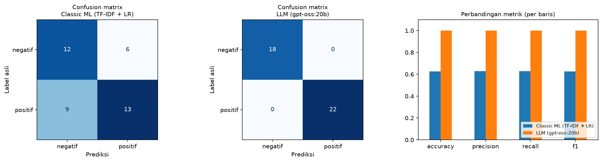

# AI Model Experiment & Evaluation: Sentiment Analysis Ulasan E-commerce

Perbandingan **Classic Machine Learning** (TF-IDF + Logistic Regression) vs **LLM lokal** (Ollama `gpt-oss:20b`) untuk klasifikasi sentimen ulasan pelanggan.

> **Status:** Kedua pendekatan sudah dijalankan dan dievaluasi pada test set yang sama. Hasil LLM berasal dari run lokal pada 10 November 2026 (tersimpan di `results/llm_predictions.csv`).

---

## 1. Problem Statement

### Objective
Tim produk e-commerce ingin membangun fitur otomatis untuk mengklasifikasikan sentimen ulasan pelanggan (positif/negatif) pada halaman produk. Sebelum memilih pendekatan untuk sistem produksi, dilakukan eksperimen awal untuk membandingkan dua kandidat pendekatan secara adil pada dataset dan test set yang sama:

1. **Model klasik**: TF-IDF + Logistic Regression (Scikit-learn), dilatih sendiri.
2. **LLM**: `gpt-oss:20b` via Ollama (lokal), memakai few-shot prompting tanpa training.

Hasil eksperimen (Accuracy, Precision, Recall, F1-Score, confusion matrix) dipakai untuk memberi rekomendasi technical approach berbasis data, dengan mempertimbangkan performa, effort implementasi, kecepatan, dan biaya.

### Target / Label
Klasifikasi biner teks pada kolom `sentiment`:

| Label | Arti | Jumlah di dataset |
|---|---|---|
| `positif` | Pelanggan puas / ulasan baik | 110 |
| `negatif` | Pelanggan tidak puas / mengeluh | 90 |

Input model: kolom `review_text` (ulasan berbahasa Indonesia). Output: `positif` atau `negatif`.

### Batasan dan Asumsi
- Hanya 2 kelas (tidak ada kelas netral).
- Label pada kolom `sentiment` dianggap ground truth yang benar.
- Dataset kecil (200 baris) sehingga hasil evaluasi perlu dibaca hati-hati.
- Dataset hanya berisi **40 teks unik** (20 positif, 20 negatif); sisanya duplikat dengan produk berbeda. Split dibuat agar teks yang sama tidak muncul di train dan test (lihat bagian 3).
- Test set yang sama dipakai untuk kedua pendekatan.
- Ulasan diasumsikan pendek, berbahasa Indonesia, tanpa sarkasme kompleks.
- Training deep learning dari nol di luar scope assignment.
- Biaya API berbayar hanya dibahas sebagai analisis/estimasi.

---

## 2. Dataset
`data/customer_reviews_sentiment.csv`: 200 baris, 4 kolom (`review_id`, `product_name`, `review_text`, `sentiment`), 15 jenis produk, ulasan pendek (rata-rata ~8 kata). Tidak ada missing value, sehingga tidak diperlukan data cleaning. Dataset asli **tidak diubah**.

| Temuan | Nilai |
|---|---|
| Total baris | 200 |
| Teks unik | 40 |
| Baris duplikat | 160 |
| Teks dengan label bertentangan | 0 |

---

## 3. Strategi Split Data dan Alasannya

Split 80:20 memakai **`StratifiedGroupKFold(n_splits=5, shuffle=True, random_state=42)`** dengan `groups = review_text`. Fold pertama menjadi test set (~20%), sisanya train set (~80%).

**Alasan:**
1. Dataset kecil dan penuh duplikat (200 baris, 40 teks unik).
2. `train_test_split(stratify=y)` hanya menjaga proporsi label, tidak peduli duplikat. Hasilnya kalimat yang sama muncul di train dan test (**data leakage**). Pada dataset ini, split biasa menghasilkan **39 dari 40 baris test** yang teksnya juga ada di train.
3. `StratifiedGroupKFold` menjaga dua hal sekaligus: **group** (kalimat yang sama selalu berada di sisi yang sama) dan **stratified** (proporsi positif/negatif tetap terjaga).
4. Test set yang sama dipakai untuk kedua pendekatan agar perbandingan adil.

| | Baris | Teks unik | Positif | Negatif | % positif |
|---|---|---|---|---|---|
| Train | 160 | 32 | 88 | 72 | 55.0 |
| Test | 40 | 8 | 22 | 18 | 55.0 |

Teks yang sama di train dan test: **0**.

**Bukti dampak leakage** (model Classic yang sama, hanya cara split yang berbeda):

| Cara split | Accuracy |
|---|---|
| `train_test_split` biasa (bocor) | 1.000 |
| `StratifiedGroupKFold` (bersih, dipakai) | 0.625 |

Skor 1.000 itu menipu: model hanya menghafal kalimat yang sama persis.

---

## 4. Ringkasan Eksperimen

### Pendekatan 1: TF-IDF + Logistic Regression
- `TfidfVectorizer(ngram_range=(1, 2))` + `LogisticRegression(max_iter=1000, random_state=42)`, dibungkus dalam satu `Pipeline` agar TF-IDF hanya di-fit pada data train di tiap fold.
- **5-fold `StratifiedGroupKFold` CV** dilakukan **hanya pada train set** untuk mengecek kestabilan. Test set dikunci sampai evaluasi akhir.
- Model akhir dilatih di seluruh train set, lalu diprediksi pada test set.

### Pendekatan 2: LLM `gpt-oss:20b` via Ollama
- **Few-shot prompting**: 6 contoh (3 positif + 3 negatif) diambil dari **train set saja**, dipilih dengan `random_state=42`.
- System prompt mewajibkan jawaban satu kata (`positif`/`negatif`).
- Jawaban di luar format ditandai `invalid` dan dihitung salah.

| Parameter | Nilai | Alasan |
|---|---|---|
| `temperature` | 0 | Klasifikasi butuh jawaban konsisten, bukan kreatif |
| `seed` | 42 | Hasil bisa diulang |
| `think` | `low` | `gpt-oss` adalah model reasoning; tugas ini sederhana sehingga reasoning ringan cukup dan lebih cepat |
| `num_predict` | 1024 | Token "berpikir" ikut dihitung; terlalu kecil bisa membuat jawaban kosong |

Teks identik hanya dipanggil sekali ke LLM (dengan temperature 0, input yang sama menghasilkan jawaban yang sama), lalu jawabannya dipakai ulang untuk baris duplikat. Prediksi disimpan di `results/llm_predictions.csv` sehingga notebook bisa dijalankan tanpa Ollama.

---

## 5. Hasil Evaluasi

Precision, Recall, dan F1 memakai **macro average** (kelas positif dan negatif sama penting). Dua level penilaian: **per baris** (test set apa adanya, 40 baris) dan **per teks unik** (duplikat dibuang, 8 teks).

### 5a. Kestabilan Classic ML (5-fold CV pada train set)

| Metrik | Mean | Std |
|---|---|---|
| Accuracy | 0.605 | 0.205 |
| Precision | 0.577 | 0.284 |
| Recall | 0.598 | 0.191 |
| F1 | 0.559 | 0.231 |

**Interpretasi:** skor antar-fold sangat bervariasi (accuracy dari 0.39 sampai 0.84; std ≈ 0.2). Setiap fold validasi hanya berisi sekitar 6-7 teks unik, sehingga satu kalimat yang salah mengubah skor sangat besar. Angka ini dibaca sebagai indikasi bahwa **performa Classic ML pada data ini tidak stabil**, bukan sebagai angka final.

### 5b. Perbandingan pada test set

| Pendekatan | Level | n | Accuracy | Precision | Recall | F1 |
|---|---|---|---|---|---|---|
| Classic ML (TF-IDF + LR) | per baris | 40 | 0.625 | 0.628 | 0.629 | 0.625 |
| Classic ML (TF-IDF + LR) | per teks unik | 8 | 0.750 | 0.750 | 0.750 | 0.750 |
| LLM (`gpt-oss:20b`) | per baris | 40 | 1.000 | 1.000 | 1.000 | 1.000 |
| LLM (`gpt-oss:20b`) | per teks unik | 8 | 1.000 | 1.000 | 1.000 | 1.000 |



**Interpretasi:** pada test set yang sama, LLM menebak benar semua ulasan (40 dari 40 baris, 8 dari 8 teks unik), sedangkan Classic ML benar 25 dari 40 baris (6 dari 8 teks unik). Selisih terbesar ada di accuracy dan F1 (1.000 vs 0.625). Perlu diingat bahwa test set hanya berisi 8 teks unik (lihat bagian 6.1 untuk batasan interpretasinya).

### 5c. Confusion matrix Classic ML (per baris)

| | Prediksi negatif | Prediksi positif |
|---|---|---|
| **Asli negatif** | 12 | 6 |
| **Asli positif** | 9 | 13 |

**Interpretasi:**
- **Accuracy 0.625:** 25 dari 40 ulasan ditebak benar.
- **Kelas negatif:** precision 57% (saat model bilang "negatif", benar 57%), recall 67% (dari semua ulasan negatif asli, 67% ditemukan).
- **Kelas positif:** precision 68%, recall 59%. Ada 9 ulasan positif yang terlewat (dianggap negatif) dan 6 ulasan negatif yang salah dianggap positif.
- Metrik per teks unik (0.75 = 6 dari 8 teks benar) lebih tinggi daripada per baris karena dua kalimat yang salah kebetulan sering muncul (total 15 baris).

**Confusion matrix LLM (`gpt-oss:20b`, per baris)**

| | Prediksi negatif | Prediksi positif |
|---|---|---|
| **Asli negatif** | 18 | 0 |
| **Asli positif** | 0 | 22 |

**Interpretasi:** seluruh 40 ulasan ditebak benar (diagonal penuh, tidak ada kesalahan di luar diagonal). Karena accuracy 1.000 dan total confusion matrix = 40, tidak ada jawaban `invalid`. Precision, recall, dan F1 pada kedua kelas semuanya 1.00.

### 5d. Kesalahan prediksi (Classic ML: 2 teks unik / 15 baris; LLM: 0)

| Teks | Label asli | Prediksi | Muncul |
|---|---|---|---|
| "Bahan murahan, tidak sesuai dengan harga yang dibayarkan." | negatif | positif | 6x |
| "Produknya rapi dan bersih, tidak ada cacat sama sekali." | positif | negatif | 9x |

Pola yang terlihat: kedua kalimat memuat kata **"tidak"**. Dugaan awal: dengan hanya ~32 teks unik untuk belajar, model bag-of-words belum cukup belajar membedakan "tidak" yang dipakai untuk **mengeluh** ("tidak sesuai") dari "tidak" yang dipakai untuk **memuji** ("tidak ada cacat"). Ini hipotesis yang perlu diuji lebih lanjut, belum kesimpulan. Catatan: LLM menebak **kedua kalimat ini dengan benar**, yang sejalan dengan dugaan tersebut tetapi belum membuktikannya.

### 5e. Kecepatan

| Pendekatan | Waktu training | Inferensi per ulasan |
|---|---|---|
| Classic ML | ~0.006 detik | ~0.03 ms |
| LLM (`gpt-oss:20b`) | 0 (tanpa training) | ~2,7 detik (rata-rata 2.667,6 ms per pemanggilan) |

Inferensi LLM sekitar **78.000x lebih lambat** daripada Classic ML (2.667,6 ms vs 0,034 ms). Teks identik hanya dipanggil sekali, sehingga total hanya 8 pemanggilan (sekitar 21 detik) untuk 40 baris test. Angka kecepatan bergantung pada hardware dan dapat berbeda antar-mesin.

---

## 6. Analisis Trade-off & Limitation

### 6.1 Performa
- **LLM lebih unggul pada test set yang sama:** accuracy dan F1 = 1.000 (40/40 baris, 8/8 teks unik), sedangkan Classic ML = 0.625 (25/40 baris) dan 0.750 (6/8 teks unik).
- **Pola kesalahan Classic ML:** 15 baris salah dari 2 teks unik, keduanya memuat "tidak" dengan makna berlawanan ("tidak sesuai" = keluhan, "tidak ada cacat" = pujian). Kesalahannya cukup seimbang: 6 negatif dianggap positif dan 9 positif dianggap negatif. LLM benar pada kedua kalimat tersebut.
- **Stabilitas:** Classic ML tidak stabil (CV accuracy 0.605 ± 0.205). LLM tidak dilatih sehingga CV tidak berlaku; konsistensinya dijaga lewat `temperature=0` dan `seed=42`.
- **Kehati-hatian membaca hasil:** test set hanya berisi 8 teks unik. Hasil 8/8 benar secara statistik masih konsisten dengan akurasi sebenarnya serendah sekitar 69% (batas bawah satu sisi 95%), dan hasil Classic ML (6/8) masih berada dalam jangkauan tersebut. Arah perbedaannya jelas, tetapi bukti statistiknya tipis.

### 6.2 Trade-off

| Aspek | Classic ML (TF-IDF + LR) | LLM (`gpt-oss:20b` via Ollama) |
|---|---|---|
| Performa (data ini) | Accuracy 0.625, F1 0.625 | Accuracy 1.000, F1 1.000 |
| Effort implementasi | Butuh data berlabel, training, dan pipeline; pipeline sendiri ringan | Tanpa training, cukup prompt (6 contoh); tetapi butuh Ollama dan model sekitar 13-14 GB |
| Kecepatan | ~0,034 ms per ulasan; training ~0,007 detik | ~2,7 detik per ulasan (sekitar 78.000x lebih lambat) |
| Biaya | Hampir nol, cukup CPU biasa | Lokal: tanpa biaya per-token, tetapi butuh RAM/GPU besar, listrik, dan maintenance. API berbayar: biaya per token (lihat 6.3) |
| Kebutuhan data | Butuh teks yang beragam; dengan hanya 32 teks unik hasilnya lemah dan tidak stabil | Beberapa contoh sudah cukup |  


### 6.3  Limitation
- **Data:** hanya 40 teks unik dengan kalimat bergaya template, dan test set hanya 8 teks unik. Hasil belum tentu berlaku untuk ulasan nyata (sarkasme, campur bahasa, ulasan netral atau campuran).
- **Perbandingan ini menguntungkan LLM** karena data latih Classic ML sangat sedikit. Dengan data yang jauh lebih banyak dan beragam, Classic ML kemungkinan membaik; hasil ini bukan bukti bahwa LLM selalu lebih baik.
- **LLM:** lambat, butuh hardware besar, hasil dapat berbeda antar versi model/hardware meskipun `temperature=0`, dan format jawaban harus divalidasi (pada eksperimen ini 0 jawaban `invalid` dari 40).
- **Evaluasi LLM** dilakukan sekali pada satu test set dengan satu desain prompt; variasi prompt belum diuji.
- Hanya 2 kelas, ulasan pendek, tanpa sarkasme.

---

## 7. Rekomendasi Technical Approach

**Rekomendasi: kembangkan pendekatan LLM (few-shot prompting) sebagai pendekatan utama pada tahap awal**, dengan klasifikasi dilakukan **secara asinkron saat ulasan masuk** dan hasilnya disimpan.

**Alasan:**
1. **Performa lebih baik pada test set yang sama** (F1 1.000 vs 0.625), termasuk pada kalimat bernegasi yang membuat Classic ML salah.
2. **Data berlabel terbatas.** Hanya ada 32 teks unik untuk training sehingga Classic ML tidak stabil (CV std ≈ 0.2). LLM tidak butuh training dan cukup dengan 6 contoh.
3. **Kelemahan utama LLM (latency ~2,7 detik per ulasan) tidak menghalangi fitur ini** bila klasifikasi dilakukan sekali saat ulasan dibuat, bukan setiap halaman produk dibuka.
4. **Biaya per ulasan kecil** karena prompt pendek (~240-280 token input, output satu kata).


---

## 8. Struktur Project

```
model-experiment-assignment/
├── README.md
├── requirements.txt
├── data/
│   └── customer_reviews_sentiment.csv     # dataset asli (tidak diubah)
├── documentation/
│   └── model_comparison_summary.png
├── notebook/
│   └── experiment_notebook.ipynb          # seluruh eksperimen
├── results
│   └── classic_cv_summary.csv
│   └── classic_prediction.csv
│   └── comparison_table.csv
│   └── llm_predictions.csv
│   └── Speed_summary.csv
```


## 9. Cara Menjalankan

**1. Buat environment dan install dependensi**
```bash
python -m venv .venv
source .venv/bin/activate        # Windows: .venv\Scripts\activate
pip install -r requirements.txt
```

**2. (Opsional, hanya untuk menjalankan ulang LLM) Siapkan Ollama**
```bash
ollama pull gpt-oss:20b          # model sekitar 13-14 GB, butuh RAM/VRAM yang cukup
ollama serve                     # jika server belum berjalan
```

**3. Jalankan notebook**
Buka `notebook/experiment_notebook.ipynb` di VS Code/Jupyter, lalu **Run All**. Notebook bisa dijalankan dari root project maupun dari folder `notebook/`.

- Jika `results/llm_predictions.csv` sudah ada, notebook **memuat cache** dan **tidak butuh Ollama**.
- Jika belum ada cache dan Ollama aktif, notebook memanggil `gpt-oss:20b` lalu menyimpan hasilnya.
- Jika Ollama tidak tersedia dan tidak ada cache, bagian LLM dilewati (tanpa error) dan hanya Classic ML yang dievaluasi.
- Untuk memaksa memanggil LLM ulang, ubah `FORCE_RERUN_LLM = True` di sel konfigurasi.

Semua proses acak memakai `random_state=42`, sehingga hasil Classic ML dapat direproduksi.
